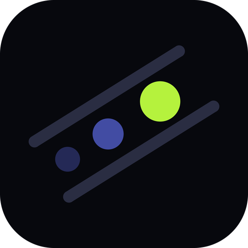
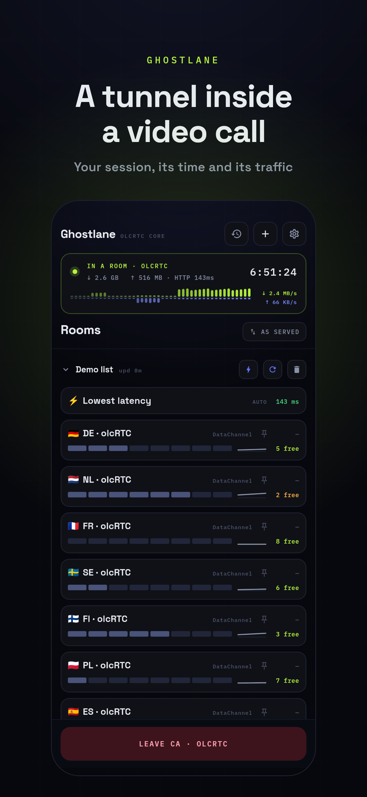
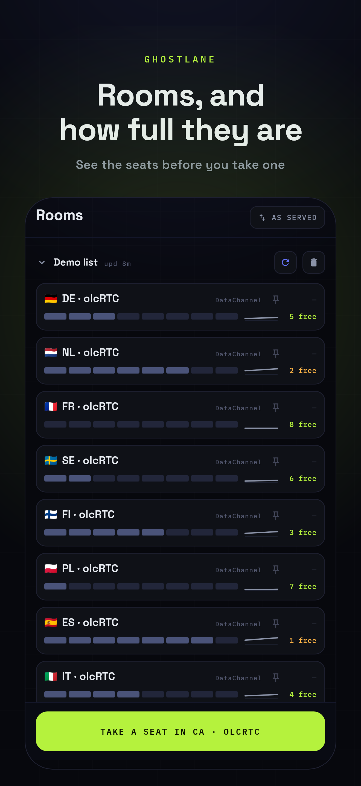
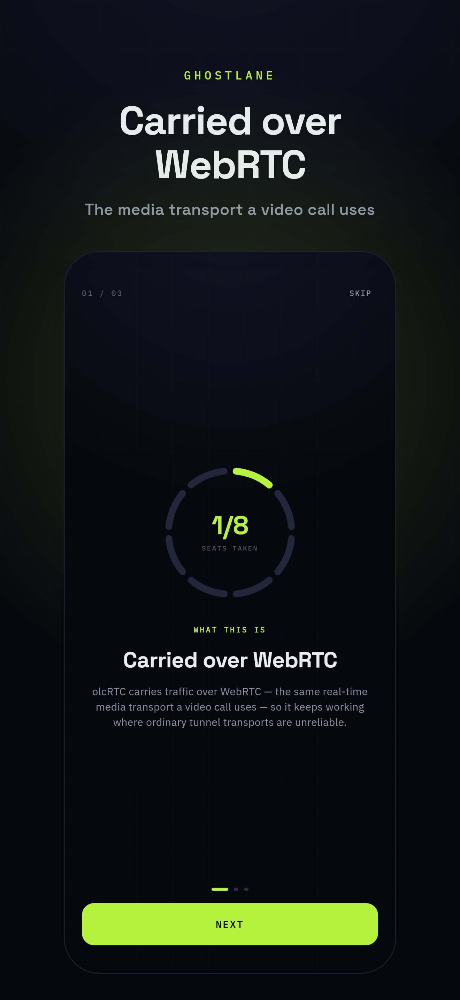
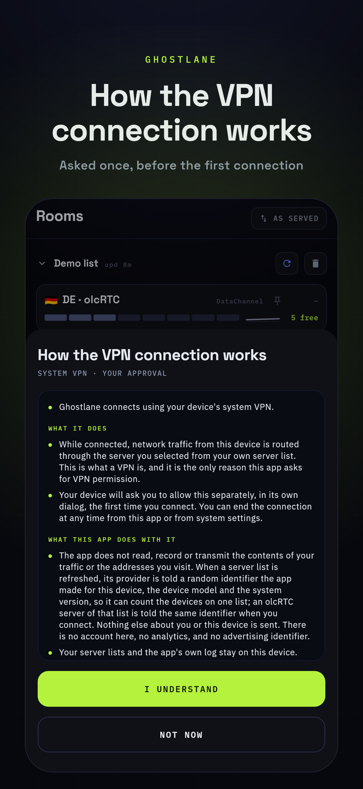
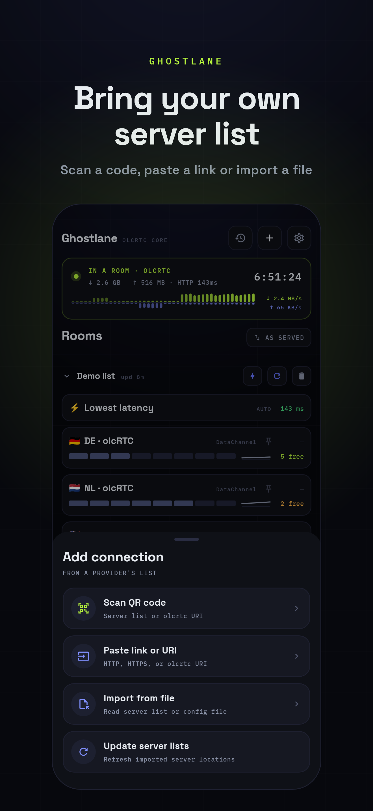

  

<h1 align="center">Ghostlane</h1>

  <b>A tunnel inside a video call.</b> 
  An open-source VPN client for Android, iOS, macOS, Windows and Linux. 
  Free, with no account, no tracking and nothing to buy.

<!-- The release badge takes no include_prereleases/sort/filter: with any of them
     shields.io lists every release of this repository (about 150, 30 assets each)
     and answers 408, which the GitHub app shows as a broken image. The plain
     endpoint reads GitHub's own "latest" release, which the release workflow
     marks. -->
<!-- Store badges: the owners' official artwork, unmodified (docs/badges/). The App
     Store badge comes first and in black, as Apple asks when other stores' badges
     are beside it. Widths, not heights: GitHub sets height:auto on README images.
     168 px shows Apple's badge 56 px tall; Google's PNG carries a transparent
     margin, so 217 px shows its badge 56 px tall too, as Google asks (the same
     size or larger). -->

  
  &nbsp;
  

  macOS, Windows, Linux, Android APKs and the Linux CLI: <a href="https://github.com/ghostlane-project/ghostlane/releases">GitHub Releases</a>

  
  
  
  

  
  
  
  
  

  <a href="docs/features.md">Features</a> · <a href="docs/protocols.md">Protocols</a> · <a href="docs/routing.md">Routing</a> · <a href="docs/server-lists.md">Server lists</a> · <a href="#download">Download</a> · <a href="SUPPORT.md">Help</a> · <a href="docs/building.md">Build</a>

## Why it exists

**olcRTC** is why this exists. Most tunnels are recognisable, and a network that inspects
what crosses it drops them on shape rather than on content. olcRTC opens a WebRTC media
session to a public meeting service and moves traffic inside it, so what stays on the
wire is a call the network already carries.

It speaks the ordinary protocols too, because a call-shaped tunnel costs bandwidth and
is not needed until it is, and the moment you need the fallback is the worst possible
moment to be installing a second app.

It is a client, not a service: you bring a server list from your provider, and the app
turns it into servers you can connect to. It is free, there is no account, nothing to
sign up for, and nothing to buy here.

## What it does

- **One tap to connect**, with the session's elapsed time and traffic on screen.
- **Rooms that show how full they are.** olcRTC relays hold a fixed number of slots, and the app shows each room's occupancy before you join one.
- **Smart connect.** Another transport when one is blocked, olcRTC in the same country when nothing else gets through (Android and the desktop).
- **Your provider's list.** By link, QR code or file, with the plan's quota and expiry read from the list's own headers. See [server lists](docs/server-lists.md).
- **Routing.** Everything through the tunnel; Russia, Iran or China direct; or only blocked sites through the tunnel, with rules of your own on top. See [routing](docs/routing.md).
- **A tunnel that holds.** On Android and the desktop a reconnect or another server happens behind the tunnel. A kill switch on iPhone and the Linux desktop, always-on VPN on Android.
- **More than phones.** Android TV, TUN and proxy modes wherever the platform has both, and each server of a list exported for a router (Podkop on OpenWrt, XKeen on Keenetic).
- **Four languages.** English, Russian, Chinese and Persian.
- **No account, no analytics, nothing collected.** See the [privacy policy](docs/privacy.md). The diagnostics log replaces server addresses with short tags, so the file is safe to send.
- **And the rest**, platform by platform: [docs/features.md](docs/features.md).

## Protocols

| Protocol | Engine |
| --- | --- |
| olcRTC, a tunnel inside a WebRTC video call | our own engine, [olcRTC](https://github.com/ghostlane-project/olcrtc) |
| VLESS with Reality or TLS, Hysteria2, Trojan, Shadowsocks, VMess | sing-box |
| XHTTP | Xray |

olcRTC rides six meeting services: Yandex Telemost, WB Stream, Sber SaluteJazz, VK Calls,
MTS Link and Jitsi. More in [docs/protocols.md](docs/protocols.md).

## Download

| Platform | Where it comes from |
| --- | --- |
| iOS | The [App Store](https://apps.apple.com/app/id6795355210). [TestFlight](https://testflight.apple.com/join/sU7aTHQv) gets every release the day it is cut; the App Store follows after App Review, so it can be a version or two behind |
| Android | [Google Play](https://play.google.com/store/apps/details?id=org.proofkit.app), or the universal and `armeabi-v7a` APKs on the [Releases](https://github.com/ghostlane-project/ghostlane/releases) page. The same app installs on Android TV |
| macOS | Signed and notarised DMG, one per architecture |
| Windows | EXE, MSI and a portable zip |
| Linux | AppImage |
| Linux servers | `ghostlane-cli`: deb, rpm, apk, Arch and tarballs for amd64/arm64/armv7 with a signed installer, signed [apt and dnf repositories](https://ghostlane-project.github.io/ghostlane/) and a Docker image (`ghcr.io/ghostlane-project/ghostlane-cli`). A headless daemon with tun (optional kill switch) and proxy modes: [docs/cli.md](docs/cli.md) |

Everything except the App Store build is produced by the release workflow on public
GitHub Actions runners and published with SHA256 sums and a build provenance attestation.
The APKs are the channel nobody can revoke; the Play bundle is the one Play updates, and
it carries no self-updater for that reason. To build it yourself: [docs/building.md](docs/building.md).

## The project

Ghostlane is open source and actively maintained: Kotlin Multiplatform and Compose, one
codebase for Android, iOS, macOS, Windows and Linux. It is developed together with
**[olcRTC](https://github.com/ghostlane-project/olcrtc)**, the transport engine it is
built around; the two repositories are one project, released separately and pinned to
each other. Every release is gated on a suite that moves real traffic through real
relays, on every supported provider, and the report of that run is attached to the release.

- How it is run, and by whom: [GOVERNANCE.md](GOVERNANCE.md) and [MAINTAINERS.md](MAINTAINERS.md). For funders and packagers: [docs/open-source-collective.md](docs/open-source-collective.md)
- Contributing: [CONTRIBUTING.md](CONTRIBUTING.md) and the [CODE_OF_CONDUCT.md](CODE_OF_CONDUCT.md)
- Getting help: bug reports, questions and feature requests go to the [issue tracker](https://github.com/ghostlane-project/ghostlane/issues). [SUPPORT.md](SUPPORT.md) says what makes a report useful and what must never be pasted into a public issue
- Security problems: the private channel in [SECURITY.md](SECURITY.md), never an issue
- Licence: MIT; the Linux CLI in `cli/` is GPL-3.0-or-later. The copyrights and licences of what ships inside are in [LICENSE](LICENSE) and [THIRD_PARTY_NOTICES.md](THIRD_PARTY_NOTICES.md)

## Funding

The app is free and stays free: nothing in it is sold, there is no account, and no
feature waits behind a payment. Ghostlane and olcRTC take their funding through
**[Open Collective](https://opencollective.com/ghostlane)**, where anyone can give once
or monthly, and every contribution and every expense is public and itemised.

**Publishing and funding are separate things.** Globvent Inc. publishes the mobile
applications on the App Store and Google Play and holds those developer accounts; that
is its only role here. Open Source Collective holds the project's funding as fiscal host,
and Globvent Inc. neither receives nor controls it: see [FUNDING.md](FUNDING.md).

> **Здесь ничего не продаётся.** Ни приложение, ни доступ, ни конфигурации, ни
> списки серверов, ни поддержка. Проект принимает только добровольное
> финансирование, через [Open Collective](https://opencollective.com/ghostlane), и
> тратит его открыто: см. [FUNDING.md](FUNDING.md).

## Legal

### Legal Notice
This software is intended for development, testing and research purposes only.

The project does not provide any guarantees regarding:
- availability of network access
- compatibility with specific services
- compliance with any external restrictions

Users are solely responsible for how they use this software and must comply with applicable laws.

### Usage Restrictions
This software is not intended to be used for bypassing access restrictions or violating applicable laws.
The project does not support or encourage such use.

### Trademarks

App Store is a trademark of Apple Inc., registered in the U.S. and other
countries. Google Play and the Google Play logo are trademarks of Google LLC.
The store badges above are their owners' official artwork, used unmodified to
link to this app's pages.
